# EchoSense — Biomimetic Haptic Wearable

-00979D)
-1FA3B8)

> **"Feel your surroundings beyond sight and sound."**

- **Live Interactive 3D Web Portal:** [https://kt2141.github.io/EchoSense-Biomimetic-Design/](https://kt2141.github.io/EchoSense-Biomimetic-Design/)
- **Presentation Deck (22 Slides):** [`EchoSense_Final_Presentation.pdf`](EchoSense_Final_Presentation.pdf)
- **Arduino C++ Firmware:** [`echosense.ino`](echosense.ino)
- **Course:** DES653: Design for Life · Department of Design, IIT Kanpur
- **Instructor:** Professor Himanshi Jangir
- **Submitted By:** Aravind K. T. (Roll No. 240169) · B.Tech Electrical Engineering, IIT Kanpur
- **Portfolios:** [kt2141.github.io](https://kt2141.github.io/) · [Google Sites Portfolio](https://sites.google.com/view/aravind-k-t-iitk/)

---

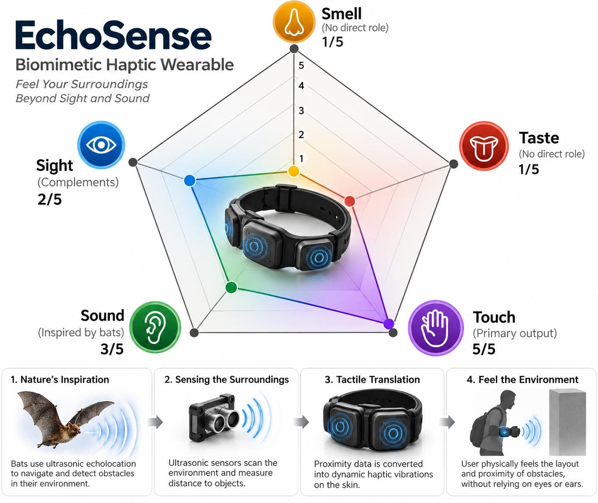

## 1. Project Overview & The "Sensory Gap"

**Problem Statement:** Visually impaired urban pedestrians need a way to detect obstacles and judge their distance early in crowded, noisy city streets, but are held back by sensory deprivation of sight and an overloaded sense of hearing that is already busy tracking traffic.

**How Might We:** *...translate the space around a visually impaired pedestrian into silent, intuitive touch cues so that they can walk confidently and independently without relying on their eyes or ears?*

| Sense | Urban Street Audit (Today) | With EchoSense (Sensory Pentagon) |
| :--- | :--- | :--- |
| **Touch** | Cane tip only, limited ground reach | **5/5 (Primary Output):** Wide-field wrist vibration zones |
| **Sound** | Overloaded (5/5) by traffic & audio prompts | **3/5 (Inspired by Bats):** Silent 40 kHz ultrasonic scan |
| **Sight** | Deprived | **2/5 (Complements):** Bypassed; dim steady status LED |
| **Smell** | Informal landmarks | **1/5 (Untouched):** Odour-neutral materials |
| **Taste** | Not used | **1/5 (Untouched):** Skin-safe, non-toxic contact |

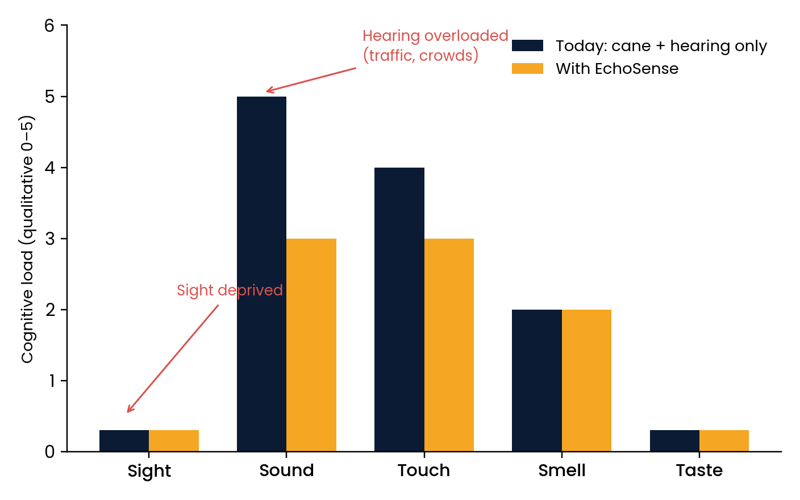

---

## 2. Biomimetic Inspiration & System Architecture

- **Chiroptera (Bat Echolocation):** Emits 40 kHz ultrasonic pulses via an `HC-SR04` module and computes Time-of-Flight distance using `d = (v × t) / 2` (`v ≈ 343 m/s` at 20°C; `5.8 ms ≈ 1.0 m`).
- ***Apis mellifera* (Honeybee Comb Geometry):** Uses hexagonal cellular tiling for the 3D-printed PLA/PETG shell texture and the spatial arrangement of 3 coin ERM vibration motors on a 3 mm breathable neoprene strap.

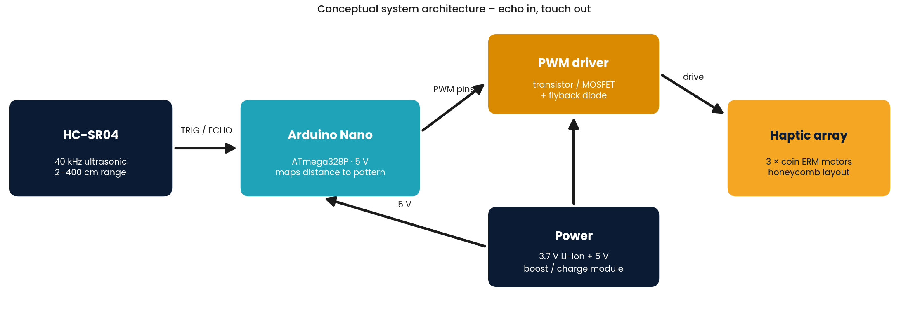
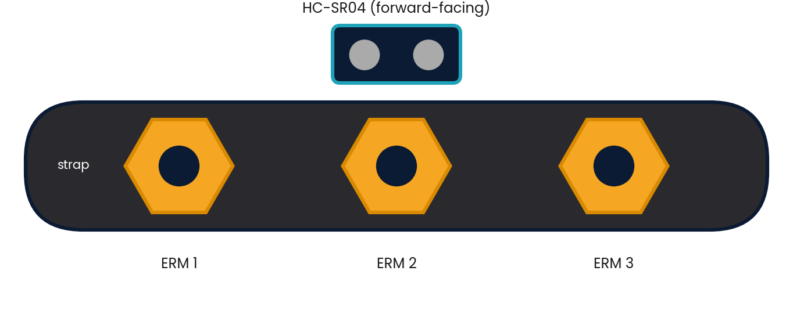

### Monotonic Tactile Language

| Zone | Obstacle Distance | PWM Duty | Haptic Pattern | User Meaning |
| :--- | :--- | :--- | :--- | :--- |
| **Clear** | `200 – 400 cm` | `0 / 255 (0%)` | Complete silence (rest at zero) | Path open; prevents skin habituation |
| **Aware** | `100 – 200 cm` | `100 / 255 (39%)` | Gentle pulse (`~1 Hz`, 150 ms on) | Obstacle ahead (e.g., pole at 1.5 m) |
| **Near** | `50 – 100 cm` | `180 / 255 (71%)` | Fast pulse (`~3 Hz`, 120 ms on) | Slow down & adjust (e.g., crowd at 0.8 m) |
| **Danger** | `0 – 50 cm` | `255 / 255 (100%)` | Continuous rapid buzz | Immediate stop (e.g., kerb < 0.5 m) |

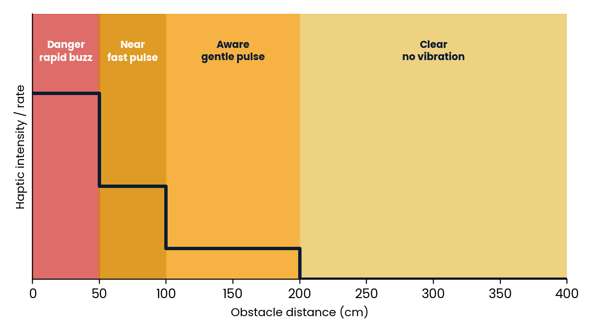
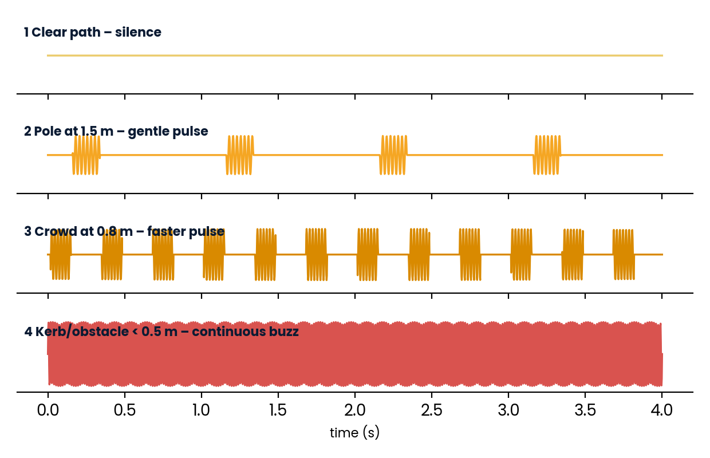

---

## 3. Digital Twin (CAD) & Low-Fidelity Mood Box Build

| 01 · Assembled CAD Render | 02 · Exploded Architecture |
| :---: | :---: |
| 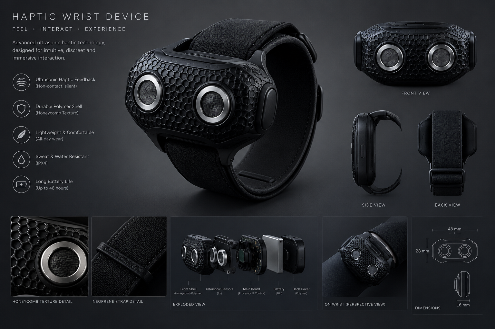 | 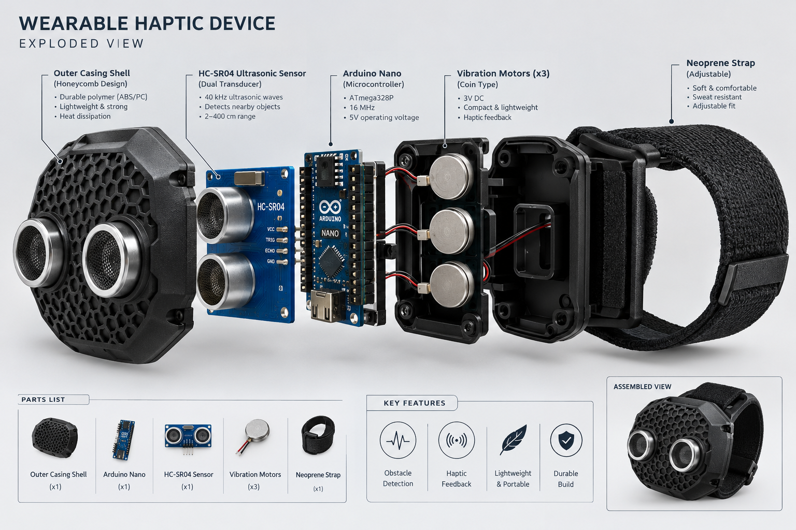 |
| **03 · 3D-Printed Honeycomb Shell** | **04 · Breathable Neoprene Wrist Setup** |
| 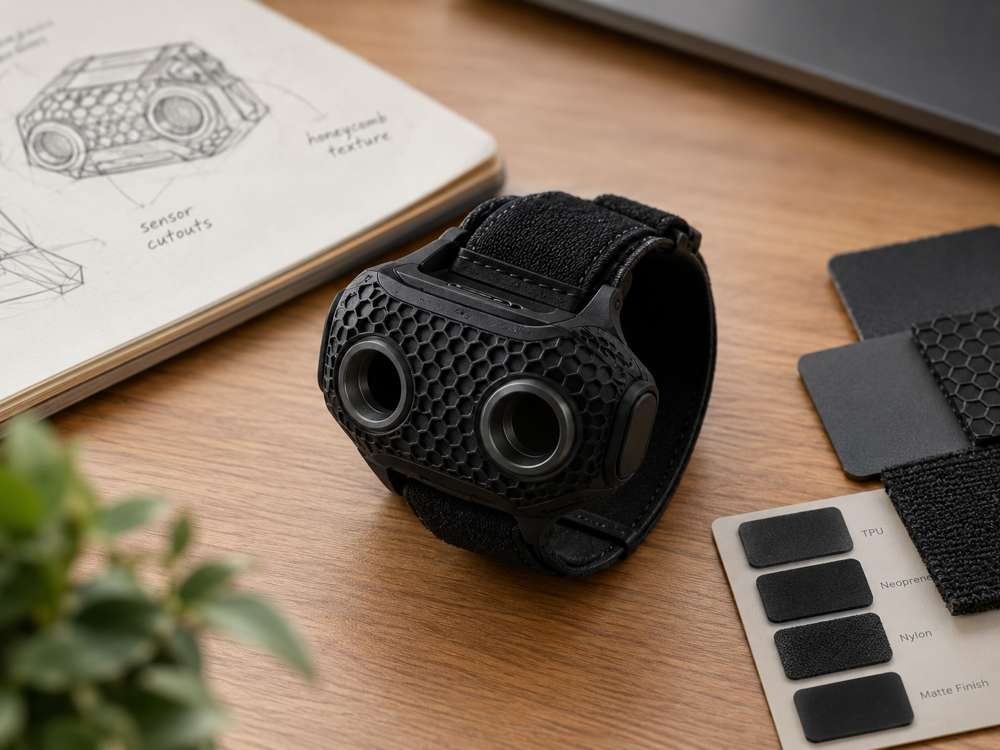 | 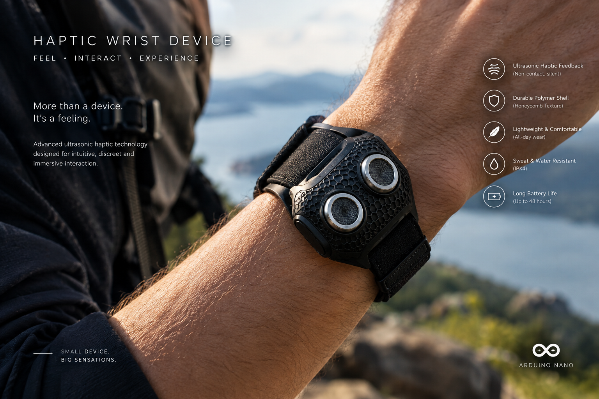 |

---

## 4. Design Journey (Double Diamond)

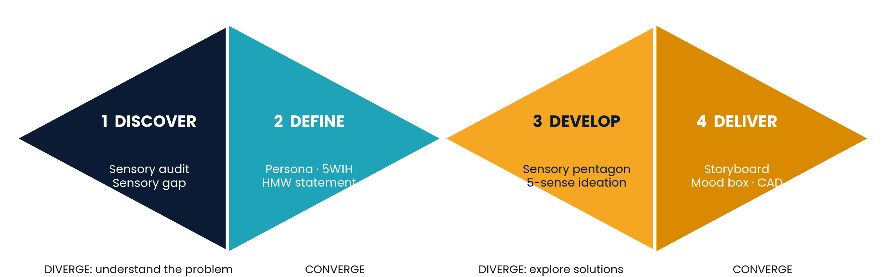

## Author

**Aravind K. T.** · Roll No. 240169 · B.Tech Electrical Engineering (2024–2028), IIT Kanpur  
Email: [aravindkt24@iitk.ac.in](mailto:aravindkt24@iitk.ac.in) · Portfolio: [https://kt2141.github.io/](https://kt2141.github.io/)
